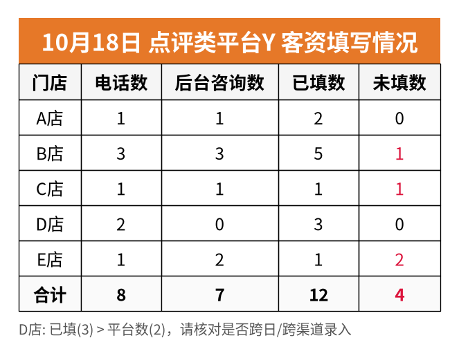
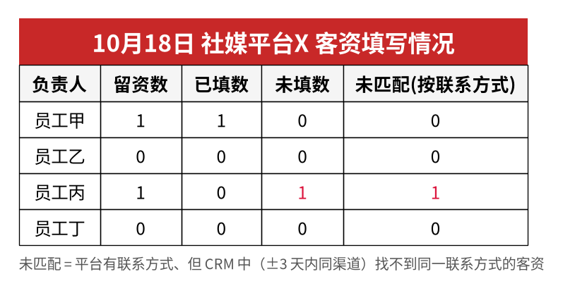

# lead-report-workflow · 全平台客资 × 任意 CRM 每日对账

> **任意线上第三方平台的客资数（广告、点评/本地生活、社媒、地图、IM/客服、表单、电商…）
> → 与任意 CRM 里的客户记录（飞书多维表格、Salesforce、HubSpot、Excel、数据库…）对账
> → 每天早晚自动出“漏填/差额”图片报表，按接收人发到各自的平台。**

销售/客服每天从很多平台接到咨询，但不一定都录进 CRM。这个工作流每天把**平台上的客资数**和 **CRM 里已录入的记录**按 *日期 × 分组（门店/人员）× 渠道* 对一遍，算出未填数，红色标出，生成可直接在聊天里预览的 PNG 图，发给需要的人。

<p>


</p>

（以上为 `python run.py demo` 用**假数据**生成的示例图）

## 架构

```
 ┌──────────── 来源适配器（N 个平台）────────────┐       ┌── CRM 适配器（可插拔）──┐
 │ api │ csv/xlsx 导出 │ browser-manual │ webhook │       │ crm-csv │ crm-sql │ custom │
 └──────────────────────┬───────────────────────┘       └───────────┬────────────┘
                        ▼                                           ▼
            normalize：字段映射 · 分组别名匹配 · 有效客资过滤 · 必填校验 · 联系方式哈希
                        ▼
            口径：按首次咨询日归属 · 切日时间 · 同一联系方式当日去重
                        ▼
            aggregate：日期 × 分组 × 渠道 计数（可选：按手机号/平台 ID 逐条匹配）
                        ▼
            reconcile：未填 = max(平台 − CRM, 0) → 红色；核销 vs 到店；响应时长超阈值
                        ▼
            render：matplotlib PNG（中文字体可配，默认 Noto Sans CJK SC）+ manifest.json
                        ▼
            route：每位接收人 → 自己的平台 / 私聊或群 / 报表 / 格式 / 是否附证据截图
```

## 功能

| 能力 | 说明 |
|---|---|
| 客资填写对账 | 每个平台一张表：分组 \| 平台客资（可拆列，如 电话数/后台咨询数） \| 已填数 \| 未填数；未填>0 标红 |
| 逐条匹配（可选） | 平台有联系方式时，按手机号/平台用户 ID（哈希后）匹配 CRM，输出“未匹配”列 |
| 核销 vs 到店 | 当月累计至数据日：按分组、按日、日×分组矩阵三张图；某店某日 核销>到店 时两格同时标红 |
| 响应时长 | 昨日各分组客服平均响应时长，超阈值标红 |
| 早晚节奏 | 早报复核**昨天**（数据最全，含核销/响应时长），晚报看**今天**（提醒当天补填） |
| 只发图片 | 默认 `format: image`，在聊天中可直接预览；可按人改为 图片+文字 / 文件 |
| 差额证据 | 有差额的分组自动附上平台列表页截图；缺截图会在 manifest 中标记，提示补拍 |
| 只看不改 | 适配器只读：不回复客户、不改平台数据、不改 CRM |
| 实时重拉 | 每次运行都重新取数；导出文件/人工读数超过 `max_age_minutes` 直接拒绝，绝不复用上一轮数字 |
| 登录失效告警 | 平台登录/扫码过期时不当作 0，相关报表暂停，向订阅 `alerts` 的人发提醒 |

## 附加模块

| 模块 | 说明 |
|---|---|
| [platform-alert](modules/platform-alert/README.zh.md) | 通用平台预警：任意平台 × 任意指标（余额/可用天数、花费、客资、响应时长、评分、差评、库存、页面任意数），规则支持 低于/高于/可用天数/环比变化%/为0或缺失；询问式向导生成配置，按接收人平台发提醒；含广告余额预警示例 |

## 平台覆盖（按类别）

适配器按**接入方式**而不是按具体平台实现，所以任何平台都能接：有 API 用 `api`，能导出用 `csv`，都不行用 `browser-manual`（人或 AI 助手在浏览器里只读读数 + 截图），能推送用 `webhook`。

| 类别 | 典型数据 | 官方 API | 导出文件 | 浏览器辅助人工 | Webhook |
|---|---|:-:|:-:|:-:|:-:|
| 广告投放（信息流/搜索/社媒广告） | 表单线索、电话线索 | ✅ 多数有线索 API | ✅ | ✅ | ✅ 线索推送 |
| 点评 / 本地生活 / 团购 | 电话数、在线咨询、核销/验券、客服响应时长 | ◑ 视开放程度 | ◑ | ✅ 最常用 | ◑ |
| 社媒 / 内容平台 | 私信留资、评论留资 | ◑ | ◑ | ✅ | ◑ |
| 地图 / 位置服务商家后台 | 来电、导航留资、客资数 | ◑ | ◑ | ✅ | – |
| IM / 客服系统 | 会话数、留资、首响/平均响应时长 | ✅ | ✅ | ✅ | ✅ |
| 官网 / 小程序 / 表单工具 | 表单提交 | ✅ | ✅ | ✅ | ✅ 首选 |
| 电商 / 市场平台 | 售前咨询、留电、订单 | ✅ | ✅ | ✅ | ◑ |
| 呼叫中心 / 400 电话 | 来电数、接通数 | ✅ | ✅ | ✅ | ✅ |
| **CRM（对账另一侧）** | 客户记录、渠道、门店、首次咨询时间、到店时间 | `custom`（多维表格/Salesforce/HubSpot API） | `crm-csv` | – | – |
| 数据库 / 数仓 | 任意视图 | `crm-sql` | – | – | – |

✅ 通常可用 ◑ 取决于平台/账号权限 – 一般不适用。接新平台见 [docs/platforms.md](docs/platforms.md)。

## 快速开始

```bash
git clone <this repo> && cd lead-report-workflow
python3 -m venv .venv && . .venv/bin/activate
pip install -r requirements.txt

python run.py demo                       # 1) 先看效果：假数据 -> examples/runs/<run_id>/*.png
python run.py init                       # 2) 问答式生成 config.yaml + .env.example（含接收人逐个询问）
python run.py validate --config config.yaml --check-env   # 3) 检查配置
python run.py run --config config.yaml --slot morning --dry-run   # 4) 试跑：只出图，写 outbox，不发送
python run.py run --config config.yaml --slot morning     # 5) 正式发送
python run.py schedule --config config.yaml               # 6) 打印 crontab
```

从零开始的完整步骤：[docs/quickstart.md](docs/quickstart.md)。现成模板：`config/templates/`（本地生活连锁、电商、教育培训），完整注释版：[config/example.yaml](config/example.yaml)。

## 让 AI 助手每天替你跑

把 [SKILL.md](SKILL.md) 交给你的 AI 助手 / Bot。它会：没有配置时按 [docs/agent-onboarding.md](docs/agent-onboarding.md) 逐项问你（平台、CRM、口径、时段、**每位接收人**的平台/私聊或群/收哪些/格式/证据/告警），然后每天按时段实时取数、对账、出图、按人发送；平台登录失效时提醒你扫码，而不是发一张全是 0 的表。详见 [docs/agent-workflow.md](docs/agent-workflow.md)。

## 目录

```
run.py                 CLI: init / validate / run / schedule / demo
core/                  normalize · aggregate · reconcile · render · pipeline · validate · init_wizard
adapters/              base 接口 · csv · http_json(api) · browser_manual · webhook_inbox · crm_base(CRM 接口 + CSV/SQL)
notifiers/             base 接口 · feishu/lark · wecom_bot · dingtalk · slack · teams · telegram · email · webhook · agent_outbox(微信等)
config/                example.yaml（全注释） · templates/
docs/                  quickstart · metric-rules · agent-workflow · agent-onboarding · platforms · images/
examples/              make_fake_data.py · demo.yaml · init-answers.example.yaml · manual-capture.template.yaml
modules/              附加模块（platform-alert 通用平台预警）
SKILL.md               给 AI 助手的每日运行说明
```

## 隐私与安全

- 密钥只放环境变量（`.env` 已被 `.gitignore`），配置里只写变量名；`validate` 会拦截明文 token / 带 token 的 URL。
- 联系方式只在内存中哈希用于去重与匹配，**不会出现在图片、manifest 或日志里**。
- 真实导出、截图、运行结果目录默认不入库（见 `.gitignore`）。截图前请遮挡手机号等个人信息。
- 平台后台的使用请遵守各平台条款；`browser-manual` 是“人/助手只读查看并记录”，不是爬虫。

---

## English

**lead-report-workflow** reconciles lead counts from *any* third-party platform (ads, reviews/local services, social, maps, IM/customer service, forms, marketplaces…) against records in *any* CRM (Bitable, Salesforce, HubSpot, spreadsheets, SQL…). Every morning (yesterday, complete data) and evening (today), it counts leads per *date × group (store/person) × channel*, computes `unfilled = max(platform − CRM, 0)`, highlights gaps in red, renders PNG tables (configurable CJK font, default Noto Sans CJK SC) and routes them per recipient (Feishu/Lark, WeCom, DingTalk, WeChat via agent outbox, Slack, Teams, Telegram, email, generic webhook) — image-only by default, with evidence screenshots for mismatches.

Also included: voucher-verification vs CRM-visit reconciliation (by group / by day / day×group matrix), response-time table, optional record-level matching by hashed phone/user ID, read-only (browse-only) principle, live re-pull rule (stale exports/captures are rejected), and auth-failure alerting (expired logins never become zeros).

Ingest methods: `api` (generic HTTP/JSON with pagination), `csv` (CSV/XLSX/JSON exports), `browser-manual` (a human or AI agent reads the back-office page and saves a capture YAML + screenshots), `webhook` (JSONL inbox + tiny receiver). CRM side: `crm-csv`, `crm-sql`, or a `custom` subclass of `CrmAdapter`.

```bash
pip install -r requirements.txt
python run.py demo        # fake data -> sample PNGs
python run.py init        # interview -> config.yaml
python run.py validate --config config.yaml
python run.py run --config config.yaml --slot morning --dry-run
```

AI agents: see `SKILL.md`. Adding a platform: `docs/platforms.md`. License: MIT.
